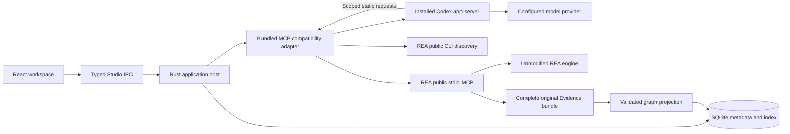

# Architecture

React consumes named, typed Studio commands through `src/integrations/desktop.ts`. It never interprets REA wire replies. Zustand owns persisted view preferences; TanStack Query owns async reads and keyed historical results. Native absence is an explicit browser-preview state, without a mock backend. Radix dialog primitives provide focus management; compact controls use a local shadcn-style design system. Tailwind 4 is available, with shared tokens and panel styles in CSS. Cytoscape and Monaco are loaded on demand; Monaco assets and workers are bundled locally, without a CDN.

The Rust host owns dialogs, selected paths, SQLite, job lifecycle, bounded reads, and typed error codes. It launches one bundled Node bridge with discrete arguments and a narrow newline-delimited request/event protocol. The bridge uses the official MCP SDK and public REA CLI. It discovers the live named contracts when connecting, then checks target-specific availability before each native query. REA owns analysis interpretation and exported Evidence. Studio's graph adapter owns JavaScript graph projection; `bridge/native.ts` owns native task admission, both observed availability inventories, exact record identity, and native display projection. React consumes those parsed display facts; labels never recover function identity. Raw facts retain original Evidence IDs and unavailable/unknown values.

The Node bridge is bundled because REA is already a Node application and the official SDK provides protocol negotiation, cancellation, schema validation, and transport supervision. Rust does not reimplement JSON-RPC or engine internals. Node is bring-your-own. Studio does not introduce an HTTP server or expose arbitrary tool execution.

SQLite schema version 3 retains the previous records and adds agent conversations, turns, activity and original-Evidence links. Schema 2 upgrades use a unique VACUUM INTO backup before the additive transaction. Schema 2 stores settings, project workflow identity, jobs, entity/edge projections, shared native record headers, and bounded logs. Schema 1 migration uses `VACUUM INTO` for a unique consistent backup, then migrates in a transaction; reopening does not repeat the migration. Unknown future schema versions fail closed. Connection setting changes retain the first configuration snapshot within SQLite. WAL supports concurrent UI reads while indexing commits one transaction. Original Evidence is authoritative and retained under `jobs/<Studio UUID>/evidence.json`; that UUID is not an Evidence identifier. Native findings reference their own Evidence header instead of inheriting a job-wide header. Header metadata excludes large raw/normalized result bodies, which remain in the complete original bundle. Temporary projections are removed after successful indexing; cleanup failures retain their owned paths.

Native operations are a closed typed selection of existing static contracts. Rust retains one native bridge for the active project's queries; that bridge owns one MCP client and REA session. Each task checks the selected path, SHA-256 and exact provider selection before reuse, reads current availability, exports the complete original bundle, and indexes only its own referenced records. Changed target bytes/provider selection reopen the session. Switching the executing project/workflow or connection settings, deletion and normal app closure explicitly retire it. Errors and cancellation retire the failed session before another task can run. A cleanup failure retains host ownership and reports unknown cleanup rather than admitting a replacement. Unexpected host termination is still unverified cleanup.

The upstream exporter has no record selector. Bundles therefore retain cumulative Evidence, and the session rotates after 128 successful queries or an export reaching 32 MiB. Exports exceeding 64 MiB remain on disk and fail indexing. These are Studio resource bounds, not claims of target coverage. Session reuse lasts within the app process; snapshots are not persisted.

The native projection owns semantic navigation: caller/callee addresses link to function dossiers; reference source/target addresses link to inspect_native_instruction. Only an observed containing procedure permits a function link. React passes exact parsed lookups and provider IDs to the typed host commands and opens the resulting finding after successful completion. Failure remains visible and never selects a stale result as the new linked result. No target launch, mutation, raw command or arbitrary MCP execution is exposed.

On restart, unfinished jobs become interrupted with cleanup unknown. The native close handler prevents normal window closure while a job is active. Cancellation sends an MCP request cancellation signal, and remains distinct from successful completion. Partial exports are not silently promoted into completed findings.

Bounds: one job, 64 MiB original bundle, 128 MiB temporary projection, 8 MiB bridge event, 200 rows/page, 300 nodes/800 edges/rendered graph, 2 MiB source/inspector, 200 log entries with at most 8192 characters each. Limits describe Studio's resource admission and views; they never imply complete upstream coverage.

Agent UI consumes named Studio commands. The host owns project/conversation scope, context bounds, global one-task admission, SQLite history, interruption recovery and Evidence indexing. The shared bridge reader supports typed progress/agent events; agent parsing and the Codex protocol remain in bridge/agent.ts. bridge/javascript.ts now owns the existing JavaScript execution once, removing its former inline representation from main.ts. Codex owns the agent loop; REA owns analysis and Evidence. Neither engine is implemented in React.

The agent canvas owns its prompt, history/project/context dialogs and presentation state. App hides the other panels for this view without modifying their persisted layout. Latest conversation data owns task admission/cancellation even while an older page is displayed; the selected turn owns its activity detail. At the latest page, history polling shares one query instead of fetching the same page twice. AgentMessage parses only the answer's Markdown and is memoized by the retained source text. Animation never synthesizes analysis phases or Evidence.

Each question owns an ephemeral Codex thread and private REA connection. Completed text is replayed explicitly from the conversation owner; no conversation-history pruning is hidden. Native queries reuse NativeSession within that question. Questions already answered with historical attached facts can avoid new analysis. Model commentary is activity; the final completed message supplies the stored answer. Transport failure, interruption, invalid scope and malformed events remain distinct from completion. Project deletion removes its owned agent directories alongside jobs after rechecking task admission.
