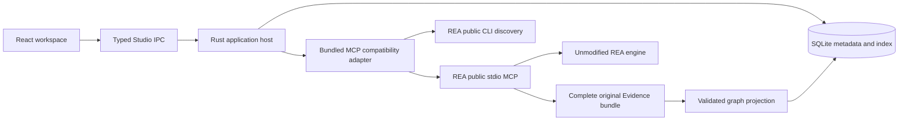

# Architecture

React consumes named, typed Studio commands through `src/integrations/desktop.ts`. It never interprets REA wire replies. Zustand owns persisted view preferences; TanStack Query owns async reads and keyed historical results. Native absence is an explicit browser-preview state, without a mock backend. Radix dialog primitives provide focus management; compact controls use a local shadcn-style design system. Tailwind 4 is available, with shared tokens and panel styles in CSS. Cytoscape and Monaco are loaded on demand; Monaco assets and workers are bundled locally, without a CDN.

The Rust host owns dialogs, approved paths, SQLite, job lifecycle, bounded reads, and typed error codes. It launches one bundled Node bridge with discrete arguments and a narrow newline-delimited request/event protocol. The bridge uses the official MCP SDK and public REA CLI. It discovers the live named contracts and availability before an analysis request. REA owns analysis interpretation and exported Evidence; Studio's adapter owns the single projection from observed graph fields into UI entity/edge models. Raw facts retain their exact IDs and unavailable/unknown values.

The Node bridge is bundled because REA is already a Node application and the official SDK provides protocol negotiation, cancellation, schema validation, and transport supervision. Rust does not reimplement JSON-RPC or engine internals. Node is bring-your-own. Studio does not introduce an HTTP server or expose arbitrary tool execution.

SQLite schema version 1 stores settings, projects, jobs, entity/edge projections, and bounded logs. Unknown future schema versions fail closed. A future migration must back up the current DB before change. Connection setting changes retain the first configuration snapshot within SQLite. WAL supports concurrent UI reads while indexing commits one transaction. Original Evidence is authoritative and retained under `jobs/<Studio UUID>/evidence.json`; that UUID is not an Evidence identifier. The temporary projection is removed after successful indexing; cleanup failures remain recorded with their owned paths.

On restart, unfinished jobs become interrupted with cleanup unknown. The native close handler prevents normal window closure while a job is active. Cancellation sends an MCP request cancellation signal, and remains distinct from successful completion. Partial exports are not silently promoted into completed findings.

Bounds: one job, 64 MiB original bundle, 128 MiB temporary projection, 8 MiB bridge event, 200 rows/page, 300 nodes/800 edges/rendered graph, 2 MiB source/inspector, 200 log entries with at most 8192 characters each. Limits describe Studio's resource admission and views; they never imply complete upstream coverage.
